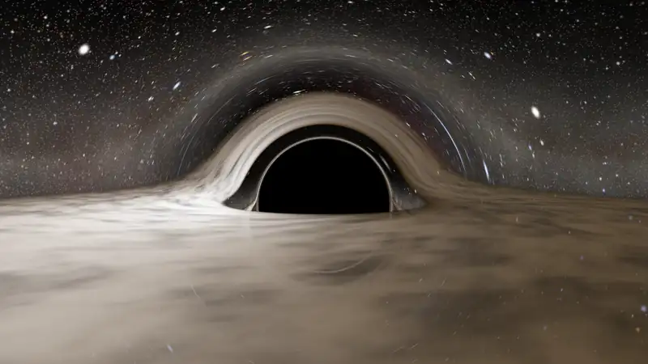
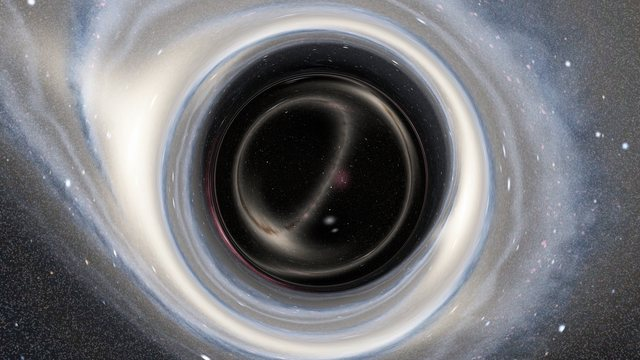
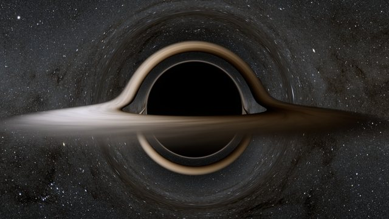
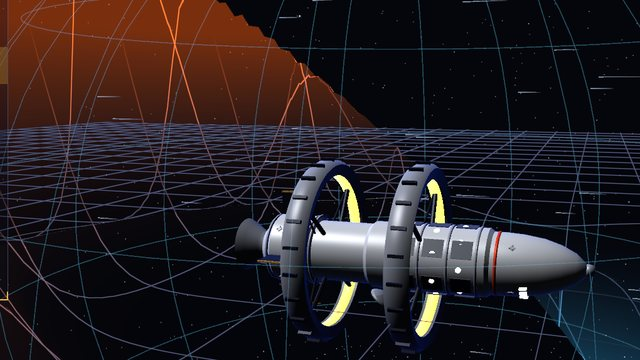
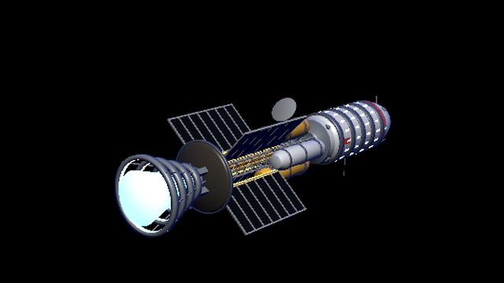
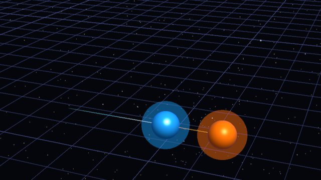
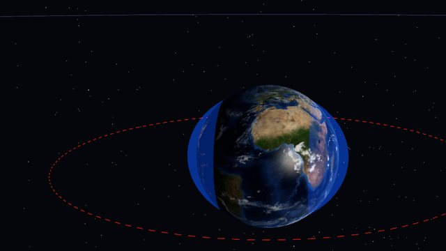
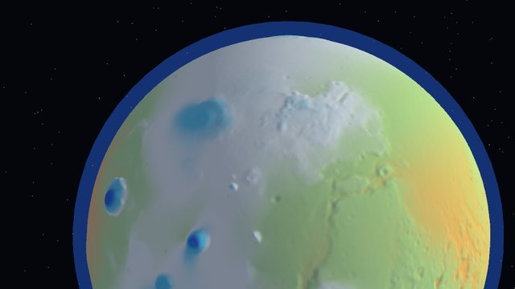
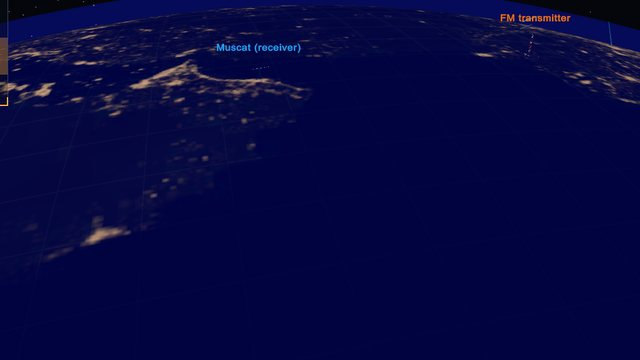

  

  
  
  
  

## ⚠️ BUILT WITH AI, NOT BY HAND

> [!WARNING]
> **I did not write this by hand.** I made this project with heavy use of AI coding assistants, including Claude Code and OpenAI Codex. Read the code and the docs with that in mind.
>
> This is a hobby project. I built it to play with physics and learn more of it. It's not for sale and I don't distribute builds. I share the source for anyone with the same interest: clone it, build it, explore it.

## OBSERVATORY

**Eight interactive physics models**, each with its assumptions explained.

<table>
<tr>
<td align="center" width="25%"> <b>WORMHOLE</b> Fly through to another sky</td>
<td align="center" width="25%"> <b>BLACK HOLE</b> Lensing, spin, tidal disruption</td>
<td align="center" width="25%"> <b>WARP BUBBLE</b> Shrink space ahead, stretch it behind</td>
<td align="center" width="25%"> <b>1G TO ANYWHERE</b> Cross the galaxy in 24 ship-years</td>
</tr>
<tr>
<td align="center"> <b>NEGATIVE MASS</b> Free acceleration forever</td>
<td align="center"> <b>MOON 1,000 KM CLOSER</b> Tides, month length, Roche limit</td>
<td align="center"> <b>TERRAFORM MARS</b> The average is a liar</td>
<td align="center"> <b>RADIO METEORS</b> Catch meteor echoes with an SDR from Muscat</td>
</tr>
</table>

The black hole uses geodesic-based lensing with numerical tracing and lens tables. Moving emission uses snapshot time; the disk is an idealized model. Each scene's limits are in <a href="docs/MODEL-FIDELITY.md">Models and limits</a>.

## ORIGIN

These scenes started in the game [Fog of War](https://github.com/NasserAlbusaidi/fog-of-war-observatory) and moved here with their full git history on 2026-10-10 ([the decision](https://github.com/NasserAlbusaidi/fog-of-war-observatory/blob/main/docs/adr/0001-open-world-game.md)). The code that both projects used was copied; the two copies now change apart.

## SYSTEM REQUIREMENTS

<table>
<tr><td><b>OS</b></td><td>Windows 10 (21H1 or newer) or 11, 64-bit</td></tr>
<tr><td><b>Tested on</b></td><td>AMD Ryzen 9 7900X · 32 GB RAM · NVIDIA GeForce RTX 4080</td></tr>
<tr><td><b>Minimum</b></td><td>Not measured yet. The ray-traced scenes have Fast, Balanced and Sharp quality.</td></tr>
</table>

<b>CONTROLS</b>

 

<table>
<tr><td><b>Pick a scene</b></td><td>1–8</td></tr>
<tr><td><b>Orbit · Zoom</b></td><td>Drag · Scroll</td></tr>
<tr><td><b>Photo mode · Clip · Screenshot</b></td><td>F10 · F9 · F12</td></tr>
<tr><td><b>Hide panels · Full screen</b></td><td>F2 or H · F11</td></tr>
<tr><td><b>All controls</b></td><td>F1</td></tr>
<tr><td><b>Menu</b></td><td>Esc</td></tr>
</table>

Rebind keys in **Esc → Settings → Controls**. 1–8, Esc, F2, H, F11 and the photo-mode camera keys are fixed.

## BUILD IT

There's no download and no store build. Build it from source:

1. Install Unity **6000.6.4f1** with Windows Build Support (Mono).
2. Clone the repo: `git clone https://github.com/NasserAlbusaidi/observatory.git`
3. Open the folder in Unity. The first import takes a few minutes.
4. To try it in the editor: **Fog of War → 1. Create and open the sim scene**, then press Play.
5. To build: **Fog of War → 2. Build Windows game**. The program lands in `Builds/Windows/FogOfWar.exe`.

The menu and the program still carry the old "Fog of War" name. A later change renames them.

## TEST IT

`Tools/qa.sh <dir>` builds the program and runs the menu shots (`uishots`) and the scene checks (`qa`). Add `tour`, `bhshots`, `physics` or `gpu` for the scene tour, the black hole shots, the geodesic checks and the GPU-against-reference check.

Full steps, every test flag and the project layout are in the **[developer guide](docs/DEVELOPING.md)**.

---

Maps: NASA Visible Earth, NASA's Scientific Visualization Studio, USGS Astrogeology and PDS. Stars: Gaia DR2 (ESA/Gaia/DPAC) and the Yale Bright Star Catalogue. Fonts: Barlow and JetBrains Mono (SIL OFL). Full credits are in the <a href="docs/DEVELOPING.md#credits-and-licence">developer guide</a>.  
Code © 2026 Nasser Albusaidi, licensed under the <a href="LICENSE">GNU General Public License v3.0</a>, with an additional permission to link with Unity. The project's own art, models and text: © 2026 Nasser Albusaidi, licensed under <a href="https://creativecommons.org/licenses/by/4.0/">CC BY 4.0</a>. Third-party maps, data and fonts keep their own licences, and the Gaia-based sky is for non-commercial use only. Details are in the <a href="docs/DEVELOPING.md#credits-and-licence">developer guide</a>.

