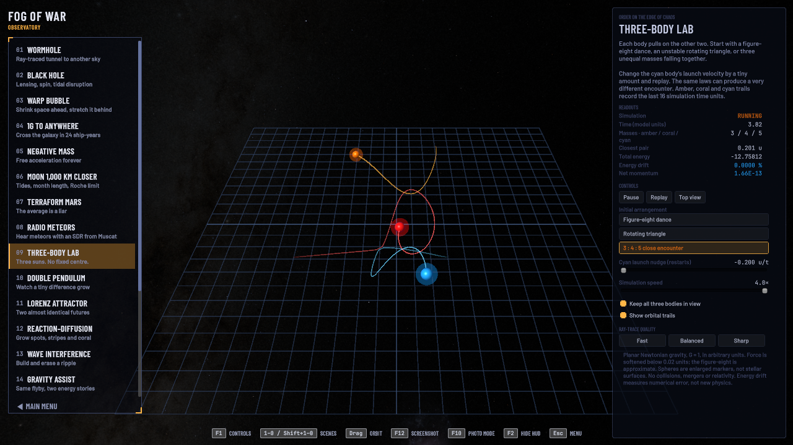
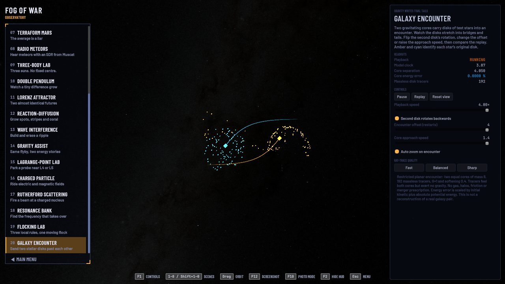

<h1 align="center">Observatory</h1>

<p align="center">
  <strong>Twenty interactive models. Change a starting condition. Watch what follows.</strong><br>
  Black holes, chaotic motion, growing patterns and worlds you can experiment with.
</p>

<p align="center">
  <a href="#build-and-run">Build and run</a> ·
  <a href="#try-these-first">First experiments</a> ·
  <a href="#all-20-scenes">All 20 scenes</a> ·
  <a href="docs/MODEL-FIDELITY.md">Models and limits</a> ·
  <a href="docs/DEVELOPING.md">Developer guide</a>
</p>

<p align="center">
  
  <br>
  <sub>The Black Hole scene: numerical light paths through a Kerr or Schwarzschild spacetime, with an idealized accretion disk.</sub>
</p>

**Observatory is a desktop collection of physics and simulation exhibits, built with Unity and C#.**
Choose a scene, change its controls, and compare the motion with live readouts.
Each exhibit explains its assumptions. The source and equations are open to inspect.

- **Experiment with cause and effect.** Change spin, gravity, phase, charge, starting angles or local steering rules.
- **Follow the numbers.** Read clocks, energies, separations and other values beside the scene.
- **Replay the labs.** Scenes 9–20 support pause, replay, speed changes and stepping while paused.
- **Capture a view.** Use photo mode, screenshots and clip recording to capture an experiment.

<table>
  <tr>
    <td width="50%" valign="top">
      <a href="docs/media/three-body-lab.png"></a><br>
      <strong>Three-Body Lab</strong><br>
      Change one launch velocity and compare the encounter.
    </td>
    <td width="50%" valign="top">
      <a href="docs/media/galaxy-encounter.png"></a><br>
      <strong>Galaxy Encounter</strong><br>
      Send two disks of stellar tracers past each other.
    </td>
  </tr>
</table>

<p align="center"><sub>Captured from the Windows build. Select a screenshot to view it at full size.</sub></p>

## Build and run

**Source only:** there is no packaged release to download. Build the Windows app with Unity.

| Requirement | Details |
|---|---|
| Platform | Windows, 64-bit |
| Editor | **Unity 6000.6.4f1**, with **Windows Build Support (Mono)** |
| Tested hardware | Ryzen 9 7900X · 32 GB RAM · GeForce RTX 4080 |
| Minimum hardware | Not measured. Fast, Balanced and Sharp settings control the ray-traced scenes. |

1. Install the editor version above. The project pins it in [ProjectVersion.txt](ProjectSettings/ProjectVersion.txt).
2. Clone the repository:

   ```sh
   git clone https://github.com/NasserAlbusaidi/observatory.git
   ```

3. Add the `observatory` folder in Unity Hub and open it. Allow the first asset import to finish.
4. Select **Fog of War → 1. Create and open the sim scene**, then press **Play**.
5. To make the app, select **Fog of War → 2. Build Windows game**.
   Run `Builds/Windows/FogOfWar.exe` when the build completes.

The Unity menu, some interface labels and the executable still use the project's earlier **Fog of War** name.

If the black hole or wormhole runs slowly, open **Esc → Settings → Graphics** and lower **Ray-trace quality**.
See the [developer guide](docs/DEVELOPING.md#open-and-build) for terminal builds and editor setup.

## Try these first

Open a scene from the rail or **Esc → Scenes**. The shortcuts below work while a scene is open.

1. **Bend light around a black hole** · `2`
   Orbit the disk. Toggle **Doppler beaming + redshift** and compare its brightness and colour.

2. **Disturb a three-body orbit** · `9`
   Select **Rotating triangle**. Compare a zero **Cyan launch nudge** with `+0.010` and watch the arrangement break apart.

3. **Watch two pendulums diverge** · `0`
   Select **Chaotic tumble**. Set **Twin's angle difference** to `0.0100°` and watch the amber and cyan tips separate.
   Pause, step and replay the same start.

4. **Grow a pattern** · `Shift+2`
   Compare **Spots**, **Maze** and **Coral** in Reaction–Diffusion. Use **Plant seed** while the model runs.
   Watch patterns spread, divide or disappear as the recipe changes.

5. **Gain or lose speed in a flyby** · `Shift+4`
   In Gravity Assist, switch **Pass side** between **Behind: gain speed** and **Ahead: lose speed**.
   Compare the speed change in the two reference frames.

In scenes 9–20, changes to starting conditions restart the model. Playback speed and camera controls preserve its state.
**Plant seed** and **Drop pulse** act on the current field.

## All 20 scenes

Use `1`–`9`, then `0`, for scenes 1–10. Hold `Shift` with the same digits for scenes 11–20.
The scene rail scrolls and follows your selection.

| Scene and shortcut | Explore |
|---|---|
| **Wormhole** · `1` | Ray-traced views through a hypothetical Morris–Thorne throat to another sky. |
| **Black Hole** · `2` | Gravitational lensing, spin, a photon ring, Doppler beaming and tidal disruption. |
| **Warp Bubble** · `3` | A prescribed Alcubierre geometry and the shape of its contracting and expanding regions. |
| **1g to Anywhere** · `4` | Constant proper acceleration, different ship and Earth clocks, aberration and Doppler colour. |
| **Negative Mass** · `5` | A theoretical runaway pair under a signed-mass Newtonian model. |
| **Moon 1,000 km Closer** · `6` | Equilibrium tides, month length and the fluid Roche boundary as lunar distance changes. |
| **Terraform Mars** · `7` | An illustrative model of energy balance, greenhouse warming and surface temperature. |
| **Radio Meteors** · `8` | Forward-scatter geometry for meteor echoes, with an observing setup based in Muscat. |
| **Three-Body Lab** · `9` | An approximate figure-eight, an unstable rotating triangle and a 3:4:5 close encounter. |
| **Double Pendulum** · `0` | Two independent pendulums whose starting angles differ by a tiny amount. |
| **Lorenz Attractor** · `Shift+1` | Twin trajectories through the Lorenz system as the convection parameter changes. |
| **Reaction–Diffusion** · `Shift+2` | Gray–Scott spots, mazes and coral patterns on a periodic grid. |
| **Wave Interference** · `Shift+3` | Two wave sources, phase changes and pulses in a field with reflecting walls. |
| **Gravity Assist** · `Shift+4` | A Newtonian flyby, viewed through two inertial frames. |
| **Lagrange-Point Lab** · `Shift+5` | A probe near L4 or L5 as the mass ratio and initial nudge change. |
| **Charged Particle** · `Shift+6` | Gyration and drift in uniform electric and magnetic fields. |
| **Rutherford Scattering** · `Shift+7` | Seventeen classical trajectories deflected by a repulsive point nucleus. |
| **Resonance Bank** · `Shift+8` | Nineteen driven, damped oscillators beside their analytic steady amplitudes. |
| **Flocking Lab** · `Shift+9` | Separation, alignment and cohesion in a group of 96 steering agents. |
| **Galaxy Encounter** · `Shift+0` | Two gravitating cores and 192 massless stellar tracers during a close pass. |

## Controls and capture

| Action | Default control |
|---|---|
| Select a scene | Scene rail, **Esc → Scenes**, or the digits above |
| Orbit / zoom | Drag / mouse wheel |
| Show controls | `F1` |
| Hide panels | `F2` or `H` |
| Photo mode | `F10` |
| Start / stop a clip | `F9` |
| Take a screenshot | `F12` |
| Toggle fullscreen | `F11` |
| Open the menu | `Esc` |

Rebind help and capture keys in **Esc → Settings → Controls**. Scene digits and the menu, panel and fullscreen keys are fixed.

**Photo mode** provides a free camera, time controls, lens and colour settings, and camera paths.
Screenshots exclude the interface and can use 1×, 2× or 4× resolution.
Captures go to `Pictures\FogOfWar` by default.

MP4 recording uses **ffmpeg** from `PATH` or `ffmpeg\ffmpeg.exe` beside the app.
Without it, recording saves PNG frames and an `encode.bat` file.
See [capture settings](docs/DEVELOPING.md#settings-and-capture) for details.

## Models and limits

The exhibits make chosen equations visible. Each model has a defined scope, numerical limits and omitted effects.

The wormhole, warp bubble and signed-mass scenes use hypothetical models.
Mars uses illustrative climate rules. Radio Meteors models radio paths and echoes; it has no live receiver feed.
Flocking uses steering rules. The galaxy encounter uses massless tracers and omits gas and stellar self-gravity.

The black hole traces light through Kerr or Schwarzschild spacetime, with numerical budgets and lens-table interpolation.
Its disk is idealized. Moving emission uses snapshot time, so different light paths do not show different source ages.

**[Read the model guide](docs/MODEL-FIDELITY.md)** for equations, integration steps, assumptions, references and validation limits.
Passing a check supports the tested case; it does not establish accuracy for every setting or long chaotic trajectory.

## Development

Run the model and scene checks from the repository root with **PowerShell 7**:

```powershell
pwsh -NoProfile -File Tools/check-chaos.ps1
pwsh -NoProfile -File Tools/check-exhibits.ps1
pwsh -NoProfile -File Tools/check-scenes.ps1
```

The first two commands compile and exercise the production C# models without Unity.
The third checks scene and control logic through limited adapters.
These checks do not test Unity rendering, physical input or frame rate.

For a Windows build, UI screenshots and native scene checks, run this in **Git Bash**:

```bash
bash Tools/qa.sh Logs/readme-check
```

The runner builds with the pinned editor, then runs `uishots` and `qa`.
Reports and screenshots go under the output directory.
If Unity is installed outside its default Hub folder, set `UNITY_EDITORS` as described in [unity-env.sh](Tools/unity-env.sh).

| Start here | Purpose |
|---|---|
| [Developer guide](docs/DEVELOPING.md) | Build commands, QA suites, capture settings and repository layout |
| [Models and limits](docs/MODEL-FIDELITY.md) | Equations, assumptions and numerical validation |
| [Scene implementations](Assets/FogOfWar/Scripts/Scenes) | Exhibit controls, drawing and model integration |
| [Scene registration](Assets/FogOfWar/Scripts/FogOfWarApp.cs) | The ordered collection of exhibits |
| [Black-hole benchmarks](Tools/benchmarks/README.md) | Reference rays and GPU comparison procedures |

For a bug report, include the scene, preset, control values, expected result and a screenshot or relevant log.
Use the repository's [issue tracker](https://github.com/NasserAlbusaidi/observatory/issues).

## About the project

Observatory is a hobby project by **Nasser Albusaidi**, made to explore physics and learn through experiments.
It is not for sale. The source is shared for others to build and explore.

The scenes grew out of **Fog of War** and moved here with their Git history.
The two projects now develop separately.

<details>
<summary>How this project was made</summary>

**I did not write this by hand.** I made this project with heavy use of AI coding assistants, including Claude Code and OpenAI Codex. Read the code and the docs with that in mind.

</details>

## Credits and licences

| Material | Terms |
|---|---|
| Code | [GPL-3.0-only](LICENSE), with an [additional permission to link with Unity](docs/DEVELOPING.md#licence) |
| Original project art and text | © 2026 Nasser Albusaidi · [CC BY 4.0](https://creativecommons.org/licenses/by/4.0/) |
| Third-party maps, data and fonts | Their own licences and attribution requirements apply |

The Gaia-based sky, and screenshots that contain it, carry **non-commercial terms**.
The [full credits and licence guide](docs/DEVELOPING.md#credits-and-licence) identifies the affected assets and their sources.

Maps and star data include work from NASA, USGS, PDS, ESA/Gaia/DPAC and the Yale Bright Star Catalogue.
The interface uses Barlow and JetBrains Mono under the SIL Open Font License.
