

  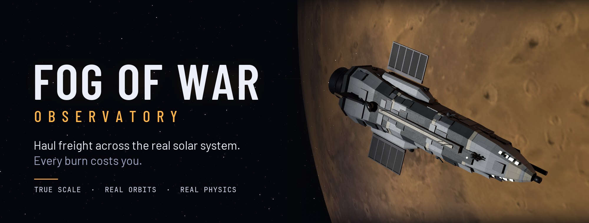

  
  
  
  
  

<i>
You're an independent torch-ship pilot in a true-scale solar system: today's date, astronomical data, and a whole system to explore. 
Take the job. Plot the burn. Watch the tank.
</i>

  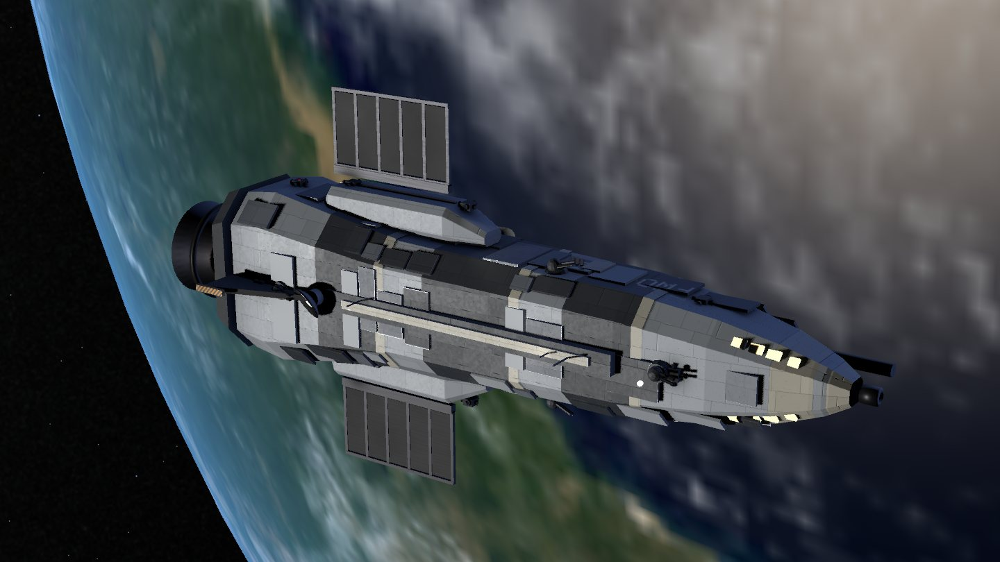
  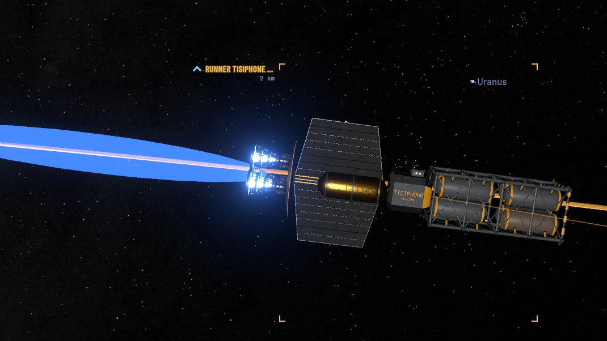
  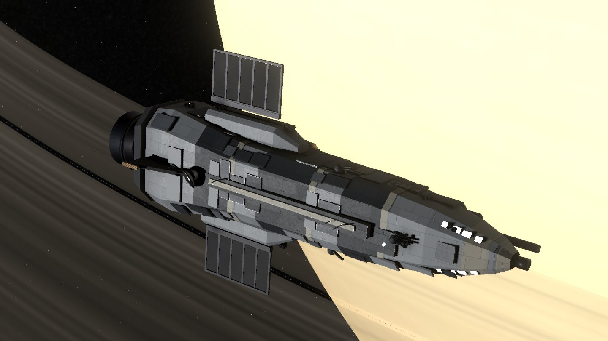

---

## ABOUT THIS GAME

**At 1 g, Mars is a few days away. Neptune is a few weeks.** The question is never *can you get there*. It's *what will it cost you*.

Every trip is a trade between **time and reaction mass**. Burn hard the whole way, flip at the midpoint and brake, and you arrive early with a dry tank. Burn, coast and burn, and you save water but cut it close on the deadline. Cargo is heavy, and heavy costs fuel. And the planets don't wait: the run that's cheap today can cost several times as much a few months from now.

Fly with astronomical data and physics-based trajectories. The fictional torch drive and idealized spacecraft systems make the journey possible; fitted ephemerides, mean-element orbits and numerical approximations make the system playable. The game finds its choices *inside* those models. Read the [models and limits](docs/MODEL-FIDELITY.md) for what each one assumes.

---

<table>
<tr>
<td width="50%">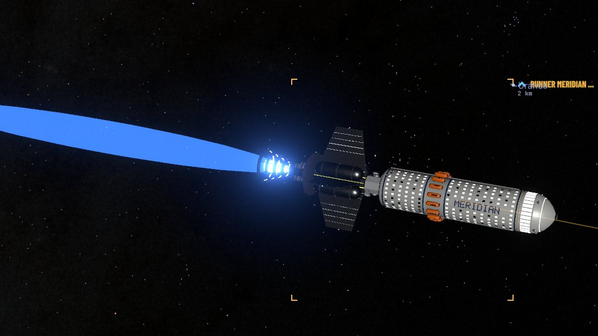</td>
<td width="50%">

### 🚀 HAUL ANYTHING, ANYWHERE

Nine ports from Earth orbit to Enceladus, held by **three factions**. Carry freight, ferry passengers (they're fragile: the drive holds at 1 g while they're aboard), survey far moons, rescue crews from dead ships, and **catch runners who won't stop for you**: match a ship under thrust, mid-burn, and hold alongside while the cargo crosses.

Boards post runs near and far. Make the **express window** for 25 % more. And a run on the autopilot isn't quiet: a distress call can come in mid-trip, or the hold cooling can fail: vent fuel to keep the cargo cold, or burn hard to beat the spoil. Out past the patrols, **raiders come for your hold**: outrun them, divert to a patrolled port, or give up a quarter of the job.

</td>
</tr>
<tr>
<td width="50%">

### 🌍 THE WHOLE SOLAR SYSTEM, FOR REAL

8 planets. **454 moons.** 21 named asteroids and a belt with its real gaps, Hildas and Trojans. Explore fitted and mean-element orbits based on NASA JPL data at today's date. Crank time compression to **1,000,000×** and watch the system turn.

You're not alone out there: **about 110 ships** fly the lanes between the ports on their own schedules, and the map shows how far each patrol reaches and where the raiders hunt.

</td>
<td width="50%">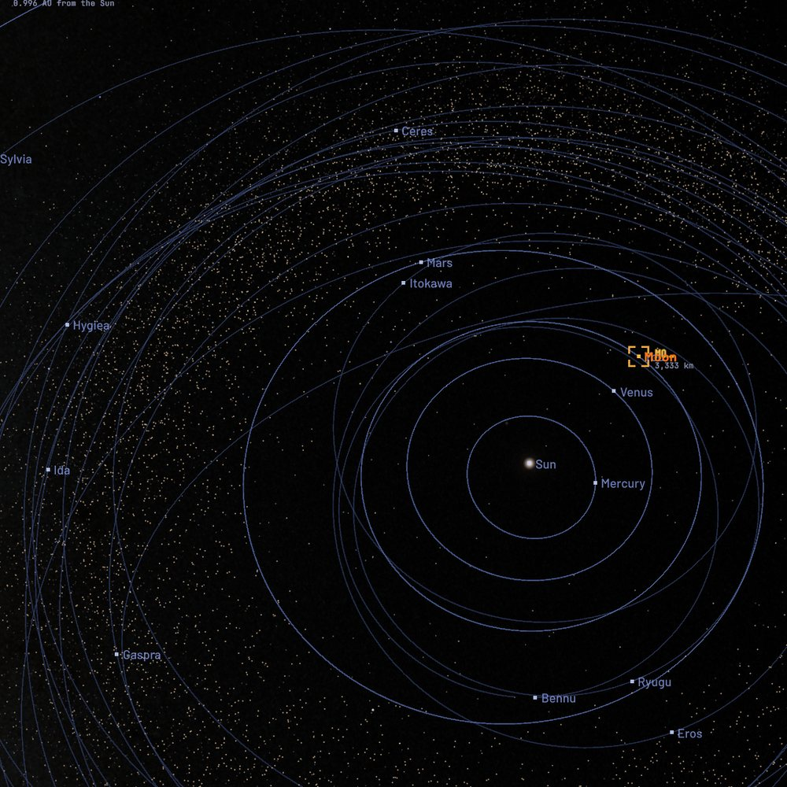</td>
</tr>
<tr>
<td width="50%">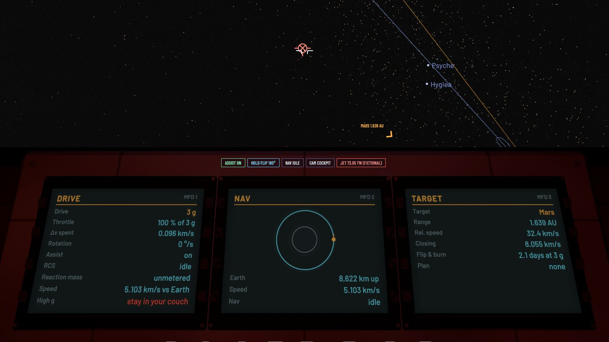</td>
<td width="50%">

### 🧑‍🚀 FLY IT YOURSELF

Chase cam, orbit cam, or **strap into the cockpit** and read it off the MFDs while the couch warns you about 3 g. Hand the burn to the autopilot and let it flip and brake for you, or take the helm for the approach: the HUD switches to approach and docking modes with a brake gauge, and **cargo or passengers flown in by hand pay 15 % more**. Set down on a planet, a moon or an asteroid, under 20 m/s or you won't walk away. On the giants, you hold at the cloud tops.

</td>
</tr>
<tr>
<td width="50%">

### 💰 BUILD YOUR SHIP, BUILD YOUR NAME

Start with 25,000 credits, a 1 g drive and a ship that belongs to the yard. Earn your way to the **3 g and 5 g drives**, bigger tanks and better sensors, then **buy the ship out: a million credits**, paid off at any port. Deliver on time and each faction pays you more on its boards. Drop the work and it pays you less. Run dry out there and you're adrift: the tender will come, but it won't be cheap.

</td>
<td width="50%">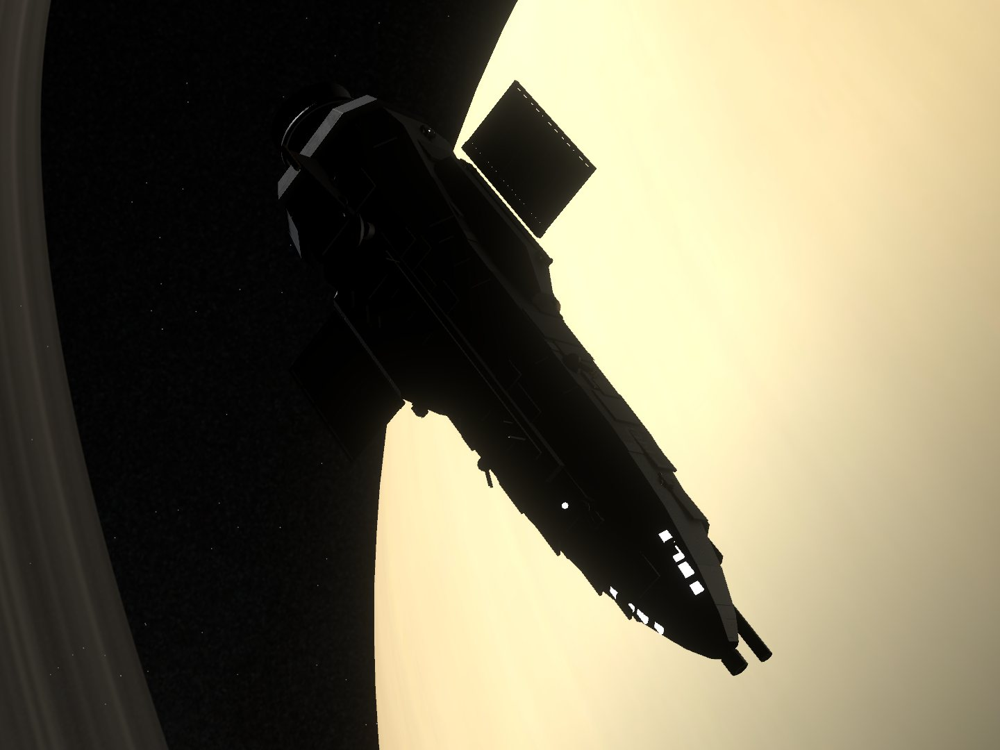</td>
</tr>
<tr>
<td width="50%">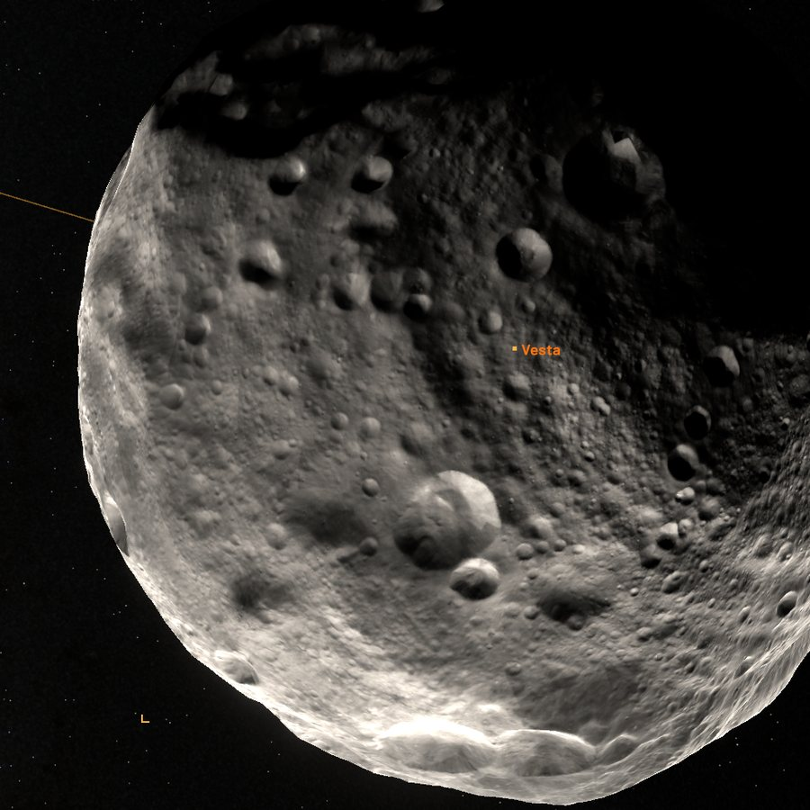</td>
<td width="50%">

### 🔭 FIND WHAT'S OUT THERE

Pass close and your codex logs the body. Scan it and real facts unlock. First scans of far moons **sell for more**, so the long trip out pays for itself. Each system's buyers pay less for every scan they already have, so keep moving. Chase 17 achievements, from your first paycheck to the edge of the map.

</td>
</tr>
</table>

  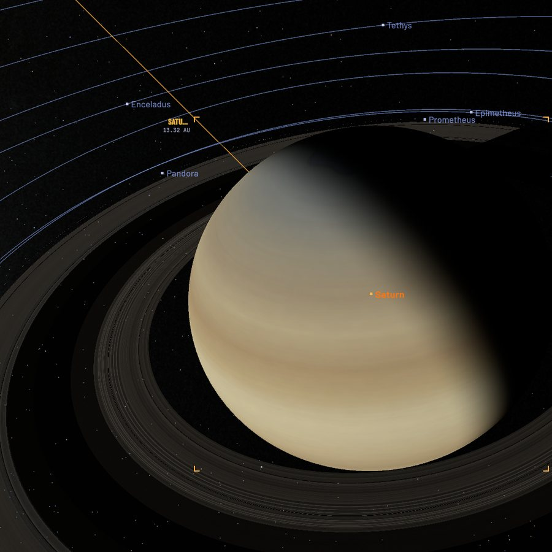
  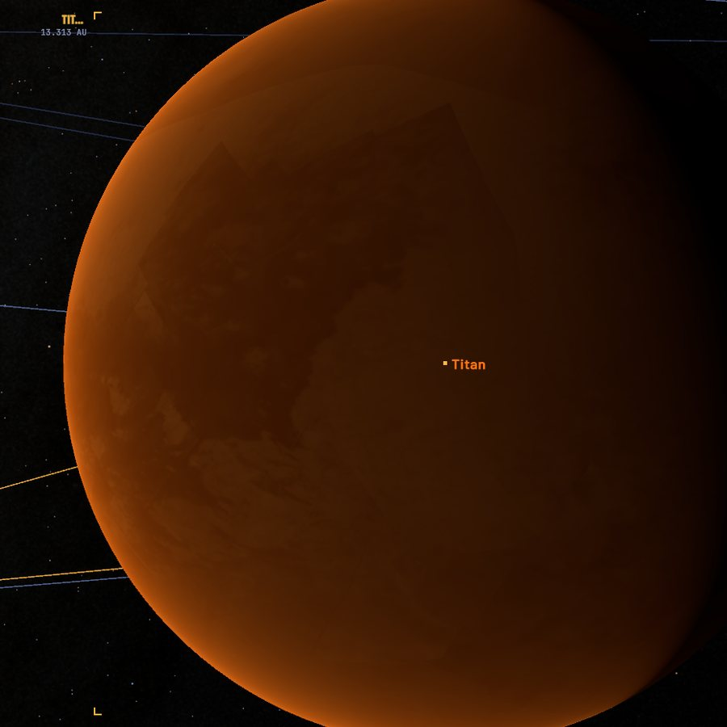
  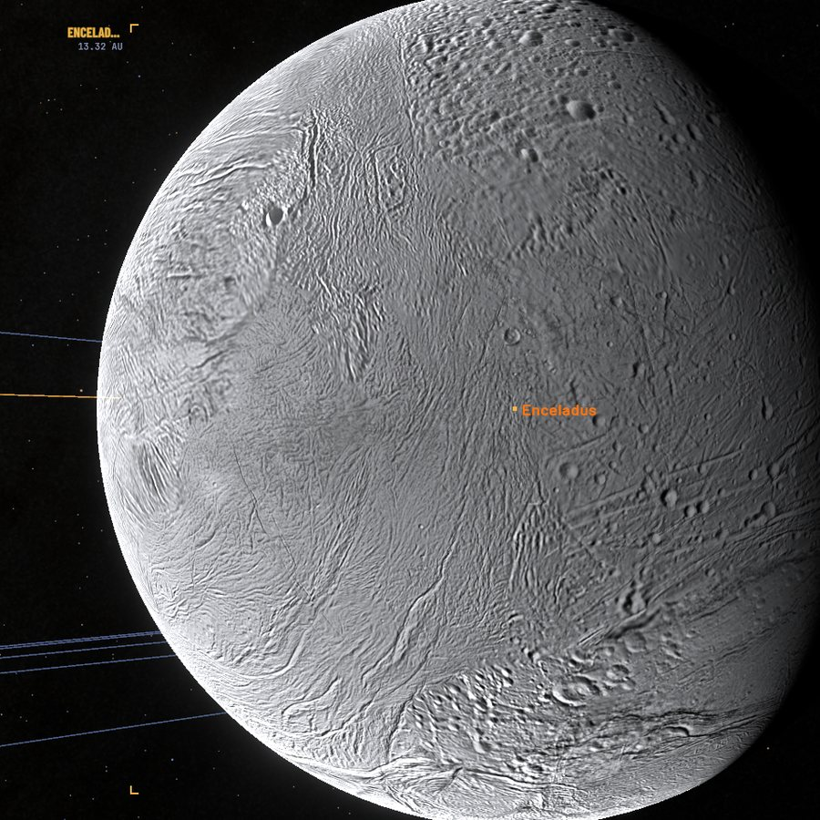

Titan and Enceladus from Cassini mosaics. Saturn modelled from Cassini imagery.

---

## THE OBSERVATORY

Step out of the cockpit and into **eight interactive physics models**, each with its assumptions explained.

  

Geodesic-based lensing with numerical tracing and lens tables. Moving emission uses snapshot time; the disk is an idealized model.

<table>
<tr>
<td align="center" width="25%"> <b>WORMHOLE</b> Fly through to another sky</td>
<td align="center" width="25%"> <b>BLACK HOLE</b> Lensing, spin, tidal disruption</td>
<td align="center" width="25%"> <b>WARP BUBBLE</b> Shrink space ahead, stretch it behind</td>
<td align="center" width="25%"> <b>1G TO ANYWHERE</b> Cross the galaxy in 24 ship-years</td>
</tr>
<tr>
<td align="center"> <b>NEGATIVE MASS</b> Free acceleration forever</td>
<td align="center"> <b>MOON 1,000 KM CLOSER</b> Tides, month length, Roche limit</td>
<td align="center"> <b>TERRAFORM MARS</b> The average is a liar</td>
<td align="center"> <b>RADIO METEORS</b> Catch meteor echoes with an SDR from Muscat</td>
</tr>
</table>

---

## FEATURES

- **True-scale solar system** on today's date, from NASA JPL ephemerides
- **Physics-based flight**: feedback-guided flip-and-burn trajectories, coast plans and the rocket equation, with integrated gravity at low time compression and conic coasts at high
- **Trucker career** with cargo, passenger, survey, rescue and intercept jobs across 9 ports and 3 factions
- **A living system**: about 110 ships on scheduled runs, patrol reach and raider havens on the map, a raider-risk line in the trip planner, and raiders that chase and board you
- **A long goal**: buy your ship out from the yard, one payment at a time
- **A first flight** that takes you from the dock to your first payday in three steps, with optional hand-flying practice
- **Autosave** at ports and on every job taken or paid, upgrade and ship payment, once you've docked at a second port
- **Flight recorder** that is always on, with an F8 bookmark for the moment you want to find again
- **Cockpit, chase and orbit views**, plus a system map and hull floodlights for the night side
- **Every sound synthesised live**: drive rumble, RCS pops, hull creaks under g. No samples.
- **Photo mode** with a free camera, lens and colour controls, cinematic flybys and MP4 clip capture (MP4 needs ffmpeg; without it you get PNG frames)
- **Planet maps from real missions**: Viking, MESSENGER, Galileo, Cassini, Dawn, LRO
- **The Observatory**: eight interactive physics models, from wormholes to radio meteors, each with its limits explained
- **Any screen**: tested from 1280×720 to 5120×1440 ultrawide and 1440×2560 portrait

---

## SYSTEM REQUIREMENTS

<table>
<tr><td><b>OS</b></td><td>Windows 10 (21H1 or newer) or 11, 64-bit</td></tr>
<tr><td><b>Storage</b></td><td>About 2.2 GB</td></tr>
<tr><td><b>Tested on</b></td><td>AMD Ryzen 9 7900X · 32 GB RAM · NVIDIA GeForce RTX 4080</td></tr>
<tr><td><b>Minimum</b></td><td>Not measured yet. The ray-traced Observatory scenes have Fast, Balanced and Sharp quality.</td></tr>
</table>

<b>CONTROLS</b>

 

<table>
<tr><td><b>Pitch · Yaw · Roll</b></td><td>W S · A D · Q E</td></tr>
<tr><td><b>Throttle up / down</b></td><td>L-Shift / L-Ctrl</td></tr>
<tr><td><b>Full throttle / cut</b></td><td>Z / X</td></tr>
<tr><td><b>RCS translate</b></td><td>H N · I K · J L</td></tr>
<tr><td><b>Flip 180°</b></td><td>F</td></tr>
<tr><td><b>Engage autopilot</b></td><td>P</td></tr>
<tr><td><b>Flight assist</b></td><td>V</td></tr>
<tr><td><b>Next target</b></td><td>Tab</td></tr>
<tr><td><b>Velocity reference</b></td><td>B</td></tr>
<tr><td><b>Time compression</b></td><td>. and ,</td></tr>
<tr><td><b>Attitude holds</b></td><td>1–9</td></tr>
<tr><td><b>Camera</b></td><td>C</td></tr>
<tr><td><b>System map</b></td><td>M</td></tr>
<tr><td><b>Jobs · Codex · Console</b></td><td>F3 · F4 · &#96;</td></tr>
<tr><td><b>Floodlights</b></td><td>G</td></tr>
<tr><td><b>Quick save · Flight-log mark</b></td><td>F5 · F8</td></tr>
<tr><td><b>Photo mode · Clip · Screenshot</b></td><td>F10 · F9 · F12</td></tr>
<tr><td><b>Hide HUD · Full screen</b></td><td>F2 · F11</td></tr>
<tr><td><b>All controls</b></td><td>F1</td></tr>
</table>

Rebind keys in **Esc → Settings → Controls**. 1–9, Esc, F2, F11 and the photo-mode camera keys are fixed.

---

## PLAY IT

There's no store build yet. Build it from source in Unity 6: open the project, then **Fog of War → 2. Build Windows game**. The repository is about 1.4 GB, most of it maps and models of the planets, moons and asteroids.

Full steps, the game rules in numbers, test tools and the project layout are in the **[developer guide](docs/DEVELOPING.md)**.

---

Orbits: NASA JPL Horizons and JPL SSD. Maps: NASA, USGS Astrogeology and PDS. Moon: NASA's Scientific Visualization Studio. Shape model of Ryugu: ISAS/JAXA (modified). Jupiter: NASA/JPL/Space Science Institute. Stars: Gaia DR2 (ESA/Gaia/DPAC) and the Yale Bright Star Catalogue. Fonts: Barlow and JetBrains Mono (SIL OFL). Full credits are in the <a href="docs/DEVELOPING.md#credits-and-licence">developer guide</a>.  
Code © 2026 Nasser Albusaidi, licensed under the <a href="LICENSE">GNU General Public License v3.0</a>. The project's own art, models and text: © 2026 Nasser Albusaidi, all rights reserved. Third-party maps, data and fonts keep their own licences, and the Gaia-based sky is for non-commercial use only. Details are in the <a href="docs/DEVELOPING.md#credits-and-licence">developer guide</a>.

